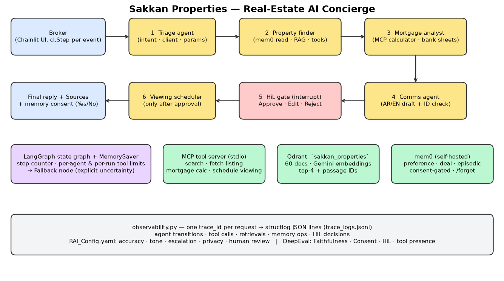
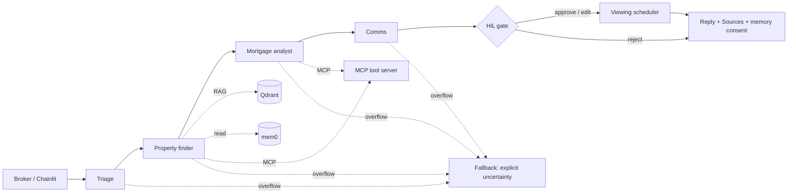

# Sakkan Properties AI Concierge — Final Report

## 1. Architecture

One LangGraph `StateGraph` with a `MemorySaver` checkpointer. State carries the plan, listings, passages, memories, mortgage results, draft and a reducer-merged `events` list that the UI streams as `cl.Step`s.

## 2. Agent roles
| Agent | Responsibility | Tools |
|---|---|---|
| Triage | Intent (find / mortgage / draft / viewing / knowledge / remember / escalate), client resolution, filters, rate/tenure/down payment, language, channel. Deterministic parser first; Gemini only fills gaps. | – |
| Property finder | mem0 read → Qdrant top-4 → exact filters via MCP; RAG hits re-rank candidates (e.g. "near international schools"); deal memory resolves "the villa we shortlisted". Repairs Pydantic validation errors from the error feedback. | `search_listings`, `fetch_listing` |
| Mortgage analyst | Amortised payment per shortlisted listing; states assumptions; lists bank sheets whose tenure/down-payment rules fit. | `mortgage_calculator` |
| Comms | Arabic/English WhatsApp, email or viewing text. LLM draft must cite only retrieved listing IDs, else a deterministic template is used. | – |
| HiL gate / Scheduler | Pause, decide, then (only after approval) book. | `schedule_viewing` |

**Limits:** 4 tool calls per agent, 10 per run, 12 graph steps. Overflow → `fallback` node: states what was verified, what is uncertain, produces no client message.

## 3. RAG and memory design
- **Corpus:** 60 plain-text docs (40 listings, 8 client briefs, 5 area guides, 3 bank sheets, 4 SOPs); one chunk per doc (long docs split on paragraphs). Gemini `gemini-embedding-001` @ 768 dims, cosine, collection `sakkan_properties`.
- **Retrieval:** top-4, returns `doc_id` + text, so every reply ends with `Sources:` IDs. Other clients' briefs are filtered out of results (privacy).
- **Exact filters vs. RAG:** structured constraints (district, price, bedrooms) go through the MCP tool for correctness; RAG supplies semantic signal and provenance.
- **mem0 (self-hosted, embedded Qdrant):** three patterns — `preference`, `deal` (carries `broker_id`), `episodic` — all stored under `user_id = client_id`, so no cross-client mixing and `/forget` is complete. Writes use `infer=False` (store exactly the consented text). **Only write path is `ClientMemory.add(..., consent=True)`**; the UI shows Yes/No and logs the decision. `/forget` returns a count, never content.

## 4. Human-in-the-loop policy
Every WhatsApp / email / viewing draft hits `interrupt()`; the graph stays paused until Approve, Edit or Reject. Silence, timeout or invalid input = **Reject** (fail closed). Rejected text is never included in the reply; edited text replaces the draft verbatim. Side effects (`schedule_viewing`) run only after Approve/Edit. This cannot be switched off (`RAI_Config.yaml`).

## 5. Evaluation results
10 fixed cases (`tests/eval_cases.jsonl`): the Hassan scenario, English email, no-match, mortgage-only, memory-based follow-up, viewing, consent declined, reject, SOP question, validation-error recovery + edit.

| Run | Cases passed | Faithfulness | ConsentRespect | HiLRespect | Tool-call presence |
|---|---|---|---|---|---|
| Offline MOCK_MODE (deterministic scorers) — `outputs/eval_report.json` | 10 / 10 | 1.00 | 1.00 | 1.00 | 1.00 |
| Live Gemini-judged (`pytest tests`) | Not run: the free-tier key was too slow / rate-limited during development | – | – | – | – |

The mock run validates the pipeline logic (routing, gating, limits, provenance); it does **not** measure LLM language quality. 6 unit tests also cover mortgage math, strict schemas, consent refusal, count-only forget, tool-limit fallback and max-step fallback.

## 6. Limitations
- Toy corpus (60 docs) and fictional banks; mortgage maths is a fixed-rate approximation, not bank-grade.
- Triage parsing is rule-based first (English + basic Arabic keywords); unusual phrasing relies on the Gemini fallback.
- MCP stdio server is spawned per call (simple, ~1 s overhead); a persistent session would be faster.
- Embedded Qdrant allows one process at a time; use Qdrant Cloud/Docker for concurrent access.
- LLM-judge scores vary slightly between runs; the deterministic checks are the stable gate.

## 7. Responsible AI decisions
No fabricated listings or prices (IDs checked against the corpus and the run's retrievals; template fallback). Mandatory human review. Consent-gated, client-scoped memory and count-only `/forget`. Logs hold IDs/counts, not memory text; other clients' IDs are redacted in errors. Escalation to a senior broker for legal, negotiation and complaint requests. Respectful Arabic/English tone with proper honorifics; mortgage figures always labelled indicative.

## 8. Demo
`docs/demo.mp4` (≈65 s, recorded in offline MOCK_MODE) shows the anchor scenario through Chainlit with every step visible, a HiL **Approve**, the memory consent prompt, and `/forget CLT-001` reporting only the count. Screenshots: `docs/chainlit_steps.png`, `docs/approved_message.png`. The same flow was exercised manually with a live Gemini key (embeddings, RAG, MCP, HiL, memory); live-judged DeepEval scores were not completed.
